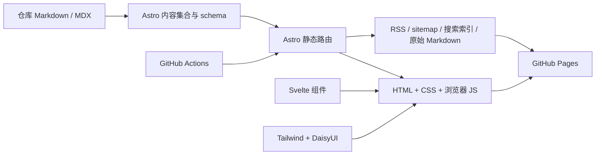

# 架构观察与复刻实现

检查日期：2026-10-22。信息来源是公开网页、其渲染后的 DOM 与公开资源；没有访问原作者的私有仓库或服务。

## 原站：能够确认的部分

| 层次 | 观察 | 证据与限制 |
| --- | --- | --- |
| 页面框架 | Astro，采用 islands 架构 | HTML 中存在 `astro-island`、`/_astro/` 资源、ClientRouter 与 Astro hydration 脚本 |
| 当前交互组件 | Svelte | 首页加载 `AsciiHero`、`ThemeSwitcher`、`TerminalPanel`、`MobileNav`，renderer 为 `client.svelte` |
| 样式系统 | Tailwind CSS v4 + DaisyUI v5 | 原作者架构文章明确说明；CSS 使用 `--color-base-*`、`--color-primary` 等变量和 DaisyUI 主题 |
| 内容来源 | Trilium ETAPI + Astro 自定义 content loader | 作者文章说明构建时拉取标记为发布的笔记，再生成文章页；演示文章还包含本地 MDX labs |
| 文章渲染 | Markdown/MDX、Expressive Code、directive/custom elements、Mermaid、Svelte islands | Authoring reference 中有对应演示 |
| 导航 | Astro ClientRouter / View Transitions | 页面加载了 `ClientRouter` 脚本，原作者提及导航时保留主题属性 |
| 用户偏好 | localStorage | 首屏内联脚本读取主题、正文与终端字体并更新 HTML 属性/CSS 变量 |
| 首页视觉 | Canvas 绘制的生成式 ASCII 动画 | Canvas 与 `Generative ASCII animation` 可访问性标签 |
| 终端 | Svelte 界面、浏览器虚拟 shell | help 列出导航、文件、文本管道、主题、编辑器及游戏命令；可切换窗口布局 |
| 部署服务 | 不能单凭网页确认当前后端 | 旧项目介绍提及 Node adapter、SSR、Docker，但它同时写 React，和现在可见的 Svelte 组件不一致 |

原站有历史信息不一致的情况：项目介绍写 Astro 5 / React 18 / Bearnie / Node adapter；较新的架构文章写 Astro / Svelte / Tailwind 4 / DaisyUI。对“当前使用什么”的判断优先采信实际加载的组件及较新的技术说明，不能把旧介绍当成当前精确依赖清单。

参考页面：

- [首页](https://codem8.dev/)
- [作者对内容管线的说明](https://codem8.dev/blog/t/how-this-blog-works/)
- [作者的项目介绍（包含历史技术栈信息）](https://codem8.dev/portfolio/codem8-home/)
- [写作功能参考](https://codem8.dev/blog/l/authoring-reference/)

原站公开链接的 GitHub 仓库为 `https://github.com/jensdn/codem8-home`；检查时网页/API 和 Git 均返回未找到，因此本项目不是它的原始源码拷贝。

## 本项目

页面采用 SSG。`getStaticPaths()` 枚举博客、项目、分类和原始 Markdown 路径。`output: 'static'` 没有 Node adapter，没有服务器端 API，也没有生产运行时进程。

`Layout.astro` 负责元数据、字体、主题初始状态、导航壳及 View Transitions。Header 的 Svelte island 在同语言的路由切换时保留，使终端会话和搜索状态不必反复初始化。导航完成后更新高亮路径；切换前把主题和字体样式传入新文档。

首页 Canvas 现在对应原站公开 AsciiHero 模块的完整绘制机制：14px 等宽字符网格、面积采样文字 mask、chamfer 距离场、固定排列的 3D simplex noise、双层字符 atlas 合成、主题色与互补色渐变、呼吸式噪声椭圆边缘。品牌文字为 MLII01。鼠标进入时使用半径 5 个网格的扰动，逐帧衰减，并传入各模拟引擎；不再使用额外的字符位移近似。

`src/lib/ascii-engines.ts` 包含 flow-field、plasma、game-of-life、reaction-diffusion、flocking、wave-interference、contour、attractor 八个引擎。它们使用与公开参考模块相同的方程、常量与更新顺序，默认逐次进入首页轮换，也可用 `?asciiEngine=plasma` 等参数选择。`src/lib/ascii/renderer.ts` 负责 Canvas、字体/主题变化、鼠标、尺寸变化和 requestAnimationFrame 生命周期。离开视口或隐藏页面会暂停，减少动态效果设置显示静态帧，触屏保留滚动。

`tests/fixtures/ascii-reference.json` 保存参考引擎在固定 80×24 网格、固定随机种子、60 帧、鼠标进入/退出条件下的输出 SHA-256。八个本地引擎的字符及 Float32 透明度轨迹全部匹配。此测试验证模拟行为；不等同于承诺不同文本、随机初态、时间点与设备的截图逐像素一致。

内容统一由 `src/content.config.ts` 校验。日期排序、草稿过滤、首页摘要、全文搜索、RSS、分类索引和终端内的文章副本来自相同内容集合。新增文章不需要手动维护菜单和索引。

文章目录由 Astro 渲染得到的 H2 / H3 标题自动生成真实片段链接。`TableOfContents.svelte` 在桌面端显示左侧吸顶导航，跟随滚动标记当前章节；小屏幕使用可展开的吸顶菜单。原生锚点保留可分享的 URL、浏览器前进/后退，以及 JavaScript 尚未加载时的跳转能力。滚动偏移为固定页头和小屏目录留出空间，动画遵循减少动态效果偏好。

Markdown directives 经过本地 remark 插件转换为语义 HTML 或 custom elements。代码由 Expressive Code 渲染；Mermaid 只在出现图表组件时动态加载。普通页面不必先加载图表库。

代码步骤支持前后按钮、直接选择步骤及方向键/Home/End。正文标题自动增加片段链接。主题同时维护浅色/深色属性，供代码高亮和 Mermaid 使用；图表保留源文本，在颜色模式改变时重新渲染。YouTube 和 CodeSandbox 由访问者点击后才创建 iframe。

终端拆成三个层次：

1. `shell.ts`：路径归一化、分词、管道、重定向、虚拟文件读写及会话序列化。
2. `Terminal.svelte`：输入、历史、补全、键盘交互、布局、nano 和命令结果。
3. `Arcade.svelte` / `games.ts`、`Adventure.svelte` / `adventure.ts`：小游戏、Wordle 评分/键盘/连胜逻辑，以及由实际文章与项目生成的文字冒险房间。

代码不调用真实系统 shell。程序输出走文本节点，文件内容不会被当成 HTML 注入。浏览器存储不可用时可以继续用内存会话。

`storage.ts` 集中处理旧品牌到 mlii01 的存储迁移。新键优先，旧键保留备份；迁移虚拟 home 路径和默认用户字段，同时保留用户笔记正文。首屏内联主题脚本也兼容旧键，避免主题闪变。

## 多语言

i18next 资源和语言清单集中在 `src/i18n/`，Astro 使用该清单生成默认英文路由与带前缀的译文路由。共享页面模板在 `src/views/`；内容、搜索、RSS、Markdown、canonical 与 hreflang 均随语言生成。缺失译文回退英文。语言切换重建 Header，使搜索索引与控件语言一致，同时保留浏览器中的主题、字体和虚拟文件。维护说明见 [I18N.md](I18N.md)。

## 适配 GitHub Pages

- `withBase()` 统一内部路径，避免 `/repo/` 部署时资源与链接丢失前缀。
- 工作流从 `actions/configure-pages` 获取 origin 和 base path。
- 文件路由输出独立目录和 `index.html`，文章刷新不依赖 SPA fallback。
- `404.html` 为未知路径提供返回入口；`.nojekyll` 防止下划线资源被 Jekyll 忽略。
- 源码分支保存 `src`、配置、锁文件和工作流；构建产物作为 Pages artifact 发布。

运行时只需静态托管。开发与构建需要 Node/npm；访问者的浏览器不需要与 Trilium、数据库或私有服务通信。

## 与原站不同的部分

保留页面与主要交互，重新实现算法和内容。使用当前兼容、已修复已知漏洞的 Astro 版本而非强行固定原站历史版本；实际版本以锁文件为准。没有复制作者的长篇文章、真实联系方式、工作履历或无法验证的项目所有权。

代码步骤保留逐步浏览及过渡效果，但没有复用原站字符级动画引擎。词表和文字冒险是本地实现。ASCII 模拟已对齐公开参考模块。原站内部 VFS 数据格式、未公开服务和构建脚本无法从网页恢复。
