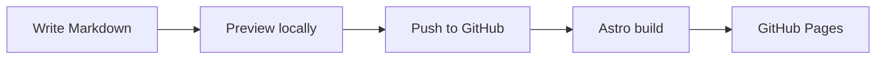

import GradientText from '../../../components/GradientText.svelte';

This page is both a writing guide and a working collection of examples. Its source lives in `src/content/blog/l/authoring-reference.mdx`. Change a paragraph, save the file, and watch the preview update.

## Categories & tags

Categories describe where a post belongs. Use slash-separated paths to create a hierarchy. Tags are small labels used by search and related posts.

```yaml title="Frontmatter"
categories:
  - Meta/Reference
tags:
  - mdx
  - examples
```

Every category level has a generated archive. A parent category includes the posts in all its children.

## Callouts

:::note
Keep a useful aside close to the paragraph it explains.
:::

:::tip
Write the content first. Add interactive components only when they help the reader.
:::

:::info
The same directive syntax works in `.md` and `.mdx` files.
:::

:::warning
Check internal links when changing a post's filename: its path is its URL.
:::

:::danger
Never place access tokens or private credentials in published content.
:::

:::caution
Preview your changes before deploying.
:::

## Inline directive: counter

This is an interactive counter: :counter{start="0" label="clicks"}. It is a small custom element, so an ordinary Markdown page can use it too.

```md
:counter{start="0" label="clicks"}
```

## Inline directive: note popover

An :pop[island]{note="A small interactive component mounted inside a page that is otherwise static HTML."} is a useful way to add interaction without turning every paragraph into a JavaScript application. Select the info button to read its definition.

## Leaf directives: embeds

You can add a video, a CodeSandbox example, or a link to a GitHub Gist. Video and sandbox embeds wait for a click before loading. Try the video below, or use the syntax to embed your own content.

::youtube{id="dQw4w9WgXcQ"}

```md
::youtube{id="VIDEO_ID"}
::sandbox{id="SANDBOX_ID"}
::gist{id="USER/GIST_ID"}
```

## Details / disclosure

:::details{summary="Click to expand"}
The content inside a disclosure stays in the page, available to search and assistive technology. This uses the browser's native details and summary elements.
:::

## Tabs

:::::tabs
::::tab{label="npm"}
```sh
npm install
npm run dev
```
::::
::::tab{label="pnpm"}
```sh
pnpm install
pnpm dev
```
::::
:::::

Use the left and right arrow keys while a tab is focused to move between examples.

## Code blocks

Fenced code uses Expressive Code for syntax highlighting, filenames, line numbers, copy buttons, and highlighted lines.

```ts title="greeting.ts" {2} showLineNumbers
export function greet(name: string) {
  return `Welcome, ${name}.`;
}
```

```ts title="sum.ts" collapse={2-4} showLineNumbers
export function sum(values: number[]) {
  // Handle the collection in a single pass.
  const total = values.reduce((a, b) => a + b, 0);
  // Return a plain number.
  return total;
}
```

## Code walkthroughs

A step-by-step code example can explain why an implementation changes. Use the arrows or numbered buttons to compare versions. The controls also support arrow keys, Home, and End.

:::::magic-move{title="greeting.ts"}
::::step{caption="A first greeting"}
```ts
const greeting = 'Hello, world.';
```
::::
::::step{caption="Make it reusable"}
```ts
function greet(name: string) {
  return `Hello, ${name}.`;
}
```
::::
::::step{caption="Add a default"}
```ts
function greet(name = 'explorer') {
  return `Hello, ${name}.`;
}
```
::::
:::::

The source renders a `code-wizard` custom element. Its steps use a short fade and slide transition; reduced-motion preferences are respected.

## Mermaid diagrams

Diagrams render lazily in the browser from a Mermaid code fence. The build still contains the diagram's text source.



## Svelte islands

An MDX document can import a Svelte component and hydrate it when it becomes visible. Click this one:

<GradientText client:visible text="Small components. Living pages." />

```mdx
import GradientText from '../../../components/GradientText.svelte';

<GradientText client:visible text="Hello, mlii01." />
```

## Images

Store images alongside your content or in `src/assets/`. Astro can optimise imported images during the build. Supply meaningful alternative text and explicit dimensions when you use an ordinary image element.

For files in `public/`, use the `withBase()` helper in Astro or MDX so project Pages URLs keep their repository prefix.
