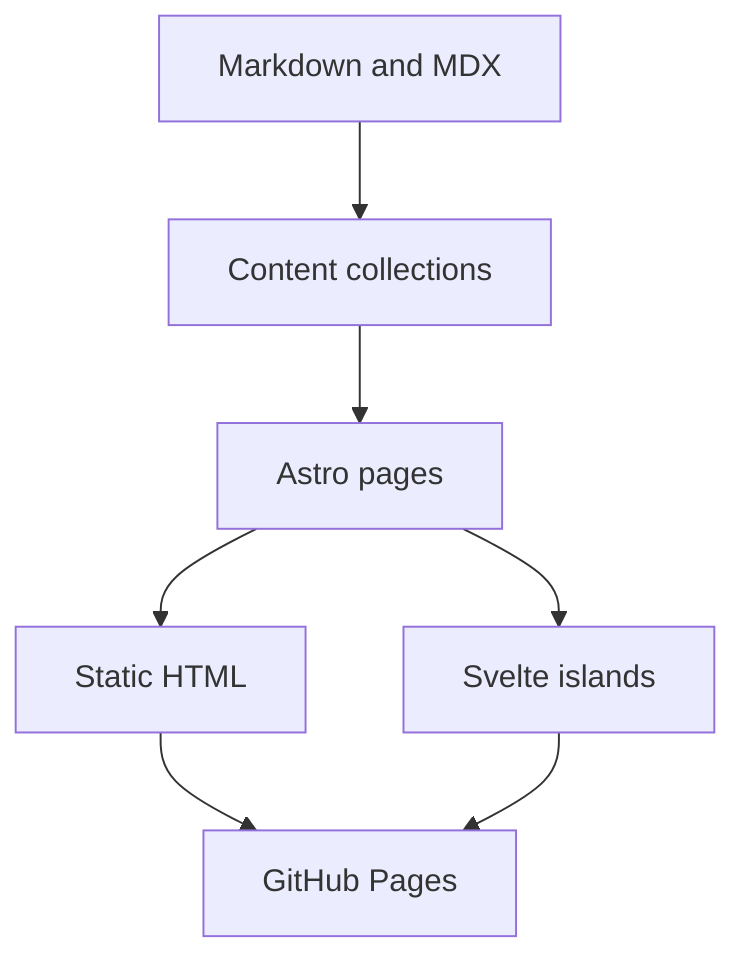

This site starts with files in a Git repository. There is no database to start, no private notes server to connect, and no runtime API needed to read an article.

## The shape of it

Astro generates a separate HTML document for every route. The browser receives readable content immediately. Svelte powers the pieces that need state: navigation controls, theme selection, search, the ASCII hero, and the terminal.



## Content collections

The content configuration validates each article's metadata. An invalid date or missing title fails the build, where it is easy to fix.

```ts title="src/content.config.ts"
const blog = defineCollection({
  loader: glob({
    pattern: '**/*.{md,mdx}',
    base: './src/content/blog',
  }),
  schema: z.object({
    title: z.string(),
    description: z.string(),
    date: z.coerce.date(),
  }),
});
```

The file path provides the URL. A post saved as `t/hello.md` becomes `/blog/t/hello/`. Drafts stay out of generated pages, search, and feeds.

## Styling and themes

Tailwind supplies the utility layer and DaisyUI supplies a complete set of colour tokens. Component styles use those tokens rather than fixed colours, so switching themes changes the whole interface.

```css
.content-card {
  background: var(--color-base-200);
  border-color: var(--color-base-300);
  color: var(--color-base-content);
}
```

The selected theme is saved in local storage. A small script applies it before the first paint, and the route transition carries it into the next document.

## The terminal

The terminal is an application inside the browser. Its filesystem is a JavaScript object containing a copy of the public posts and a writable home directory.

Commands are parsed by a small interpreter. File operations affect this virtual filesystem. They cannot access the computer hosting the browser or change the published site. Browser storage preserves edits and command history between visits.

Try a pipeline:

```sh
cat /README.md | grep site
echo "A note for later" > notes.txt
cat notes.txt
```

## GitHub Pages paths

A user site runs at `/`, while a project site can run at `/repository/`. Links, fonts, scripts, feeds, and search results all need the same base path.

The deployment workflow reads that path from GitHub Pages. Local previews can set `BASE_PATH` to exercise the same layout before publishing.

## Publishing

Push the source to the `main` branch after enabling GitHub Actions as the Pages source. The workflow installs the locked dependencies, checks types, runs the small regression suite, builds the site, and publishes the generated directory.

The generated files are disposable. The components and content in `src/` are the source of truth.
