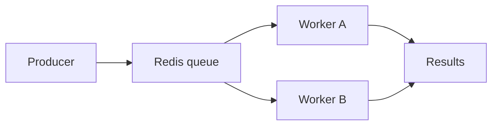

## A queue between services

This is an editable example project entry. Replace it with a project you have built when you personalise the portfolio.

The concept is a small job queue: a producer submits work, Redis holds it, and workers process jobs independently. Keeping each message small makes the system easier to inspect and retry.



## Reliability

An implementation would need to distinguish queued, active, completed and failed jobs. Retries should be bounded, and workers should handle repeated delivery safely.

```ts title="job.ts"
interface Job<T> {
  id: string;
  payload: T;
  attempts: number;
  createdAt: string;
}
```

## Project notes

The card, technology filters and this detail page are generated from one Markdown file. Add a real repository URL to its `github` field when the project is ready to share.
