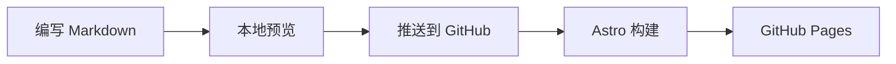

import GradientText from '../../../../../components/GradientText.svelte';

这既是写作指南，也是一组可操作的示例。中文源码位于 `src/content/translations/zh/blog/l/authoring-reference.mdx`。修改文字并保存，即可在本地预览中看到变化。

## 分类与标签 \{#categories--tags\}

分类表示文章所属的位置，用斜线分隔的路径建立层级。标签用于搜索和相关文章。译文保留相同的分类与技术标签，确保语言切换时路径稳定。

```yaml title="Frontmatter"
categories:
  - Meta/Reference
tags:
  - mdx
  - examples
```

每个分类层级都有生成的归档页。父分类包含所有子分类中的文章。

## 提示框 \{#callouts\}

:::note
把补充说明放在它所解释的段落附近。
:::

:::tip
先写内容，只在有助于读者理解时添加交互组件。
:::

:::info
相同的指令语法同时适用于 `.md` 和 `.mdx`。
:::

:::warning
修改文章文件名时记得检查内部链接：文件路径就是网址。
:::

:::danger
不要把访问令牌或私人凭据放进公开内容。
:::

:::caution
发布前先预览修改。
:::

## 行内指令：计数器 \{#inline-directive-counter\}

这是交互计数器：:counter{start="0" label="次点击"}。它是一个小型自定义元素，因此普通 Markdown 页面也可以使用。

```md
:counter{start="0" label="次点击"}
```

## 行内指令：注释弹窗 \{#inline-directive-note-popover\}

:pop[交互岛]{note="嵌入静态 HTML 页面的小型交互组件。"}可以为页面添加交互，无需把每一段文字都变成 JavaScript 应用。点击信息按钮查看定义。

## 块级指令：嵌入内容 \{#leaf-directives-embeds\}

可以添加视频、CodeSandbox 示例或 GitHub Gist 链接。视频和沙盒在点击之后才加载。试试下方视频，或用示例语法嵌入自己的内容。

::youtube{id="dQw4w9WgXcQ"}

```md
::youtube{id="VIDEO_ID"}
::sandbox{id="SANDBOX_ID"}
::gist{id="USER/GIST_ID"}
```

## 折叠内容 \{#details--disclosure\}

:::details{summary="点击展开"}
折叠内容仍保留在页面中，供搜索和辅助技术访问。这里使用浏览器原生的 details 和 summary 元素。
:::

## 选项卡 \{#tabs\}

:::::tabs
::::tab{label="npm"}
```sh
npm install
npm run dev
```
::::
::::tab{label="pnpm"}
```sh
pnpm install
pnpm dev
```
::::
:::::

选项卡获得焦点后，可以用左右方向键切换示例。

## 代码块 \{#code-blocks\}

代码块使用 Expressive Code，支持语法高亮、文件名、行号、复制按钮和重点行。

```ts title="greeting.ts" {2} showLineNumbers
export function greet(name: string) {
  return `Welcome, ${name}.`;
}
```

```ts title="sum.ts" collapse={2-4} showLineNumbers
export function sum(values: number[]) {
  // 一次遍历处理所有元素。
  const total = values.reduce((a, b) => a + b, 0);
  // 返回一个数值。
  return total;
}
```

## 分步代码 \{#code-walkthroughs\}

分步示例可以解释实现为何改变。使用箭头或数字按钮比较版本，也可以用方向键、Home 和 End 操作。

:::::magic-move{title="greeting.ts"}
::::step{caption="第一个问候"}
```ts
const greeting = '你好，世界。';
```
::::
::::step{caption="封装为函数"}
```ts
function greet(name: string) {
  return `你好，${name}。`;
}
```
::::
::::step{caption="添加默认值"}
```ts
function greet(name = '探索者') {
  return `你好，${name}。`;
}
```
::::
:::::

源码会生成 `code-wizard` 自定义元素。步骤切换使用简短的淡入与滑动效果，并遵循系统的减少动态效果设置。

## Mermaid 图表 \{#mermaid-diagrams\}

浏览器按需加载 Mermaid 并渲染图表。构建结果仍保留图表的文本源码。



## Svelte 交互组件 \{#svelte-islands\}

MDX 文档可以导入 Svelte 组件，并在组件可见时加载交互。试着点击它：

<GradientText client:visible text="小组件，让页面动起来。" label="Svelte 交互组件" />

```mdx
import GradientText from '../../../../../components/GradientText.svelte';

<GradientText client:visible text="你好，mlii01。" />
```

## 图片 \{#images\}

图片可以放在内容旁边或 `src/assets/` 中。Astro 会在构建时优化导入的图片。使用普通图片元素时，应提供有意义的替代文本和明确尺寸。

引用 `public/` 中的文件时，使用 `withBase()` 处理基础路径。页面导航链接则使用 `localizedPath()`，同时保留项目路径和语言前缀。
