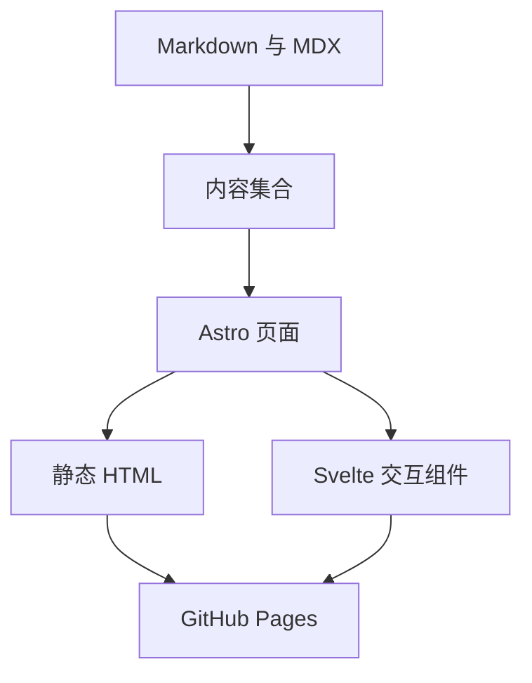

网站从 Git 仓库中的文件开始。阅读文章不需要运行数据库、连接私人笔记服务，也不依赖运行时 API。

## 整体结构 {#the-shape-of-it}

Astro 为每条路由生成独立的 HTML 文档，浏览器可以立即显示内容。导航控件、主题选择、搜索、ASCII 动画和终端等需要状态的部分由 Svelte 驱动。



## 内容集合 {#content-collections}

内容配置会验证文章元数据。缺失标题或无效日期会让构建失败，方便在发布前修正。

```ts title="src/content.config.ts"
const blog = defineCollection({
  loader: glob({
    pattern: '**/*.{md,mdx}',
    base: './src/content/blog',
  }),
  schema: z.object({
    title: z.string(),
    description: z.string(),
    date: z.coerce.date(),
  }),
});
```

文件路径决定网址。例如 `t/hello.md` 对应 `/blog/t/hello/`，中文版为 `/zh/blog/t/hello/`。草稿不会出现在生成的页面、搜索或订阅中。

## 样式与主题 {#styling-and-themes}

Tailwind 提供工具类，DaisyUI 提供一套完整的颜色变量。组件使用这些变量，所以切换主题会同步改变整个界面。

```css
.content-card {
  background: var(--color-base-200);
  border-color: var(--color-base-300);
  color: var(--color-base-content);
}
```

主题会保存在浏览器中。一个小脚本在首次绘制之前应用设置，页面切换也会保留它。

## 终端 {#the-terminal}

终端是运行在浏览器里的应用。它的文件系统是一个 JavaScript 对象，包含公开文章的副本和可写的用户目录。

命令由一个小型解释器处理。文件操作只影响虚拟文件系统，无法访问浏览器所在的计算机或修改已发布网站。浏览器存储会保留编辑内容和命令历史。

试试管道命令：

```sh
cat /README.md | grep site
echo "稍后再看的笔记" > notes.txt
cat notes.txt
```

## GitHub Pages 路径 {#github-pages-paths}

用户站点运行在 `/`，项目站点可能运行在 `/repository/`。链接、字体、脚本、订阅和搜索结果都必须使用相同的基础路径。语言前缀放在它后面，例如 `/repository/zh/`。

部署工作流会从 GitHub Pages 读取路径。本地可以设置 `BASE_PATH`，在发布前验证项目路径。

## 发布 {#publishing}

在仓库的 Pages 设置中选择 GitHub Actions，然后把源码推送到 `main` 分支。工作流会安装锁定版本的依赖、检查类型、运行回归测试、构建并发布网站。

生成文件可以随时重新构建，`src/` 中的组件和内容才是需要维护的源码。
