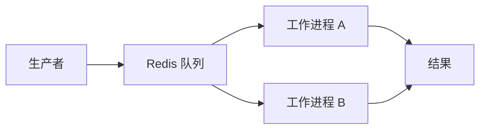

## 服务之间的队列 {#a-queue-between-services}

这是一条可编辑的示例项目。完善个人作品集时，请把它替换为你实际完成的项目。

基本思路是一个小型任务队列：生产者提交任务，Redis 保存任务，工作进程独立处理。保持消息简短，有助于检查问题和执行重试。



## 可靠性 {#reliability}

实际实现需要区分排队、运行、完成和失败状态。重试次数应有上限，工作进程还应安全地处理重复投递。

```ts title="job.ts"
interface Job<T> {
  id: string;
  payload: T;
  attempts: number;
  createdAt: string;
}
```

## 项目说明 {#project-notes}

项目卡片、技术筛选器和详情页都从同一个 Markdown 文件生成。项目可以分享时，在 `github` 字段添加真实的仓库地址。
